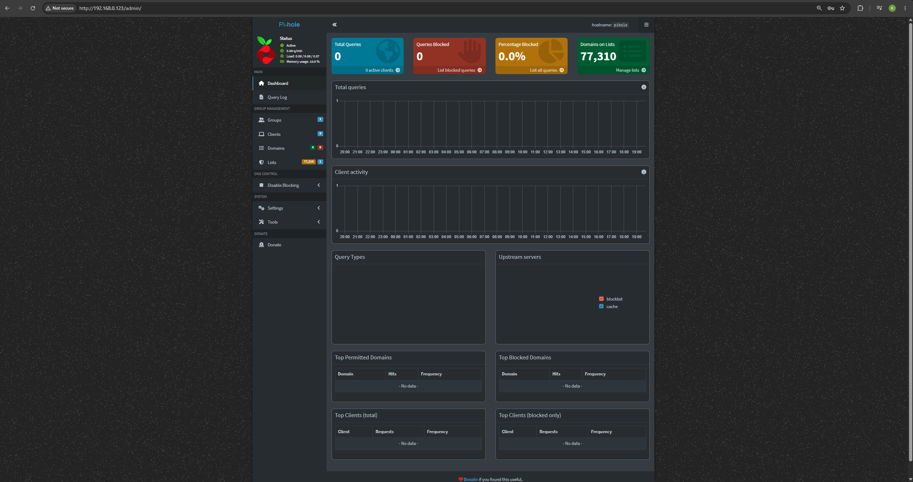
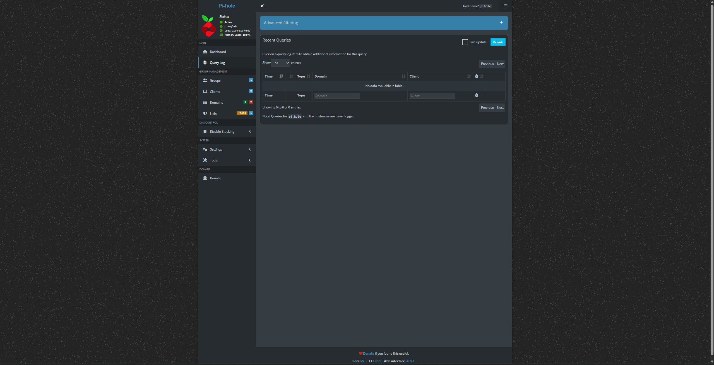
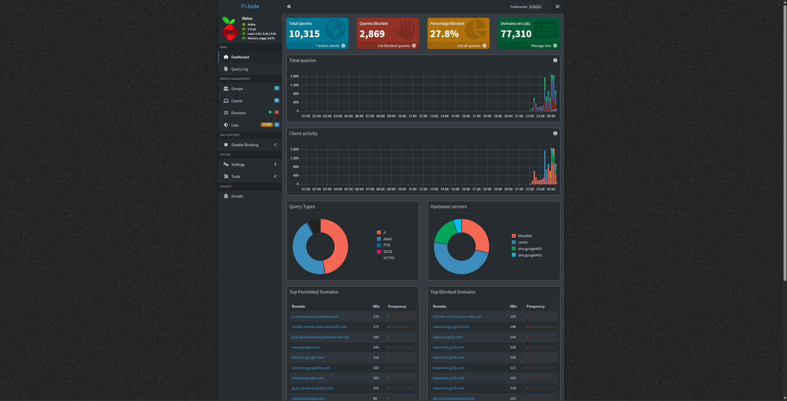
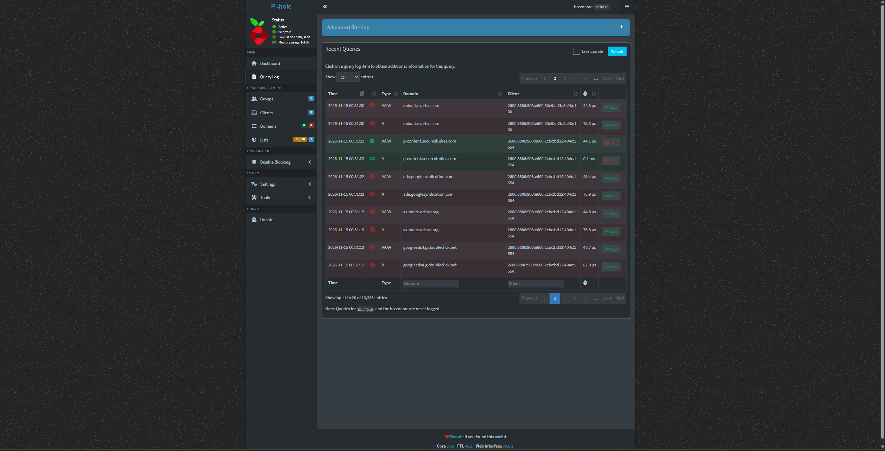

# 04 - Pi-hole Dashboard

## Overview

After installing Pi-hole, I accessed its web administration interface to monitor DNS activity, manage settings, and view statistics about blocked queries.

## Accessing the Dashboard

The Pi-hole dashboard can be accessed from any device connected to the local network by navigating to:

```text
http://192.168.0.123:80/admin
http://pi.hole:80/admin
```

The IP address above is the Raspberry Pi's reserved Ethernet address or you could use the domain name. 

After opening the URL, I logged in using the password configured during installation.



## Dashboard Overview

The dashboard provides an overview of DNS activity across the network. Some of the key statistics include:

| Statistic | Description |
|---|---|
| Total Queries | Total number of DNS requests received by Pi-hole |
| Queries Blocked | Number of DNS requests blocked by Pi-hole |
| Percent Blocked | Percentage of DNS requests that were blocked |
| Domains on Blocklist | Number of domains included in the configured blocklists |
| Clients | Devices that have sent DNS queries to Pi-hole |
| Queries Over Time | Graph showing DNS activity over time |

## Query Log

The Query Log provides a more detailed view of individual DNS requests. It displays information such as the requested domain, the client that made the request, and whether Pi-hole allowed or blocked it.

This is useful for troubleshooting DNS issues and understanding which domains devices are requesting.



## Populated Dashboard and Query Log

Having end devices DNS configured to Pihole, this is what the populated data looks.





## What I Learned

- How to access and navigate Pi-hole's web administration interface.
- How to monitor DNS activity across the network.
- How to interpret query statistics and blocked-query percentages.
- How to identify which clients are sending DNS requests.
- How to use the Query Log to investigate individual DNS requests.