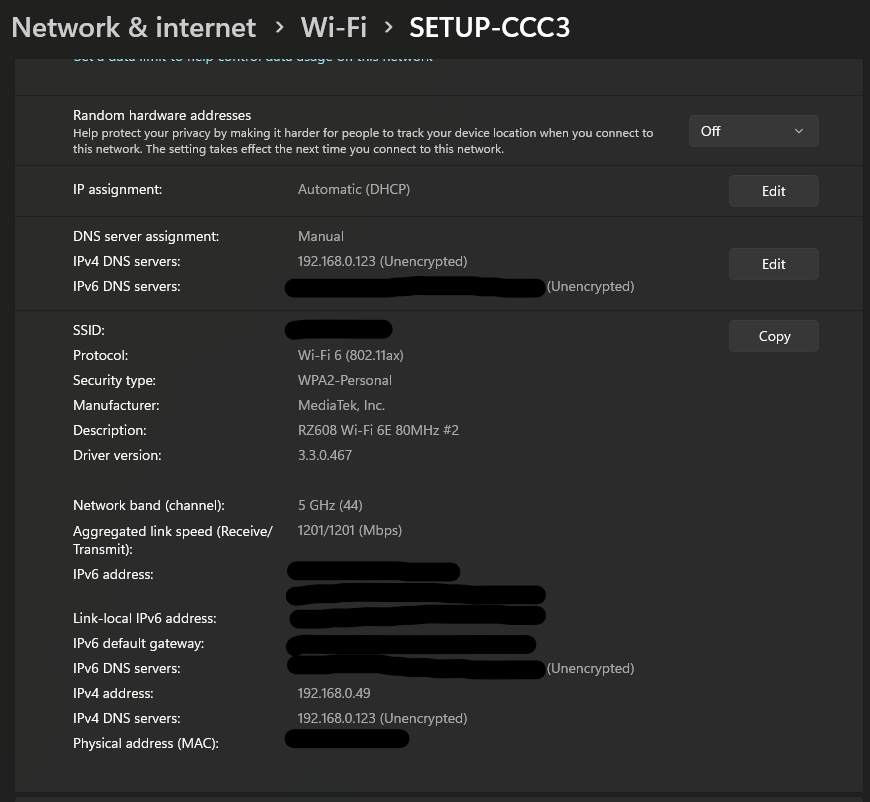

# 05 - End Device Configuration

## Overview

Configure a Windows 11 PC to use the Raspberry Pi running Pi-hole as its DNS server. Since my router does not allow manual DNS configuration, I configured the DNS settings directly on the Windows PC.

This allows the PC to send DNS requests through Pi-hole for filtering and monitoring.

## Windows 11 DNS Configuration

I accessed the network settings through:

**Settings → Network & Internet → Wi-Fi → DNS Server Assignment**

I changed the DNS server assignment from Automatic to Manual.

### IPv4 Configuration

| Setting | Value |
|---|---|
| DNS Assignment | Manual |
| Preferred DNS | `192.168.0.123` |
| Alternate DNS | Not configured |
| DNS over HTTPS | Off |

The IPv4 address `192.168.0.123` is the reserved address assigned to the Raspberry Pi running Pi-hole.

### IPv6 Configuration

I also configured IPv6 DNS to prevent Windows from sending DNS requests directly to the ISP's DNS servers.

| Setting | Value |
|---|---|
| Preferred DNS | Pi-hole's global IPv6 address |
| Alternate DNS | Not configured |
| DNS over HTTPS | Off |

Using both IPv4 and IPv6 ensures that DNS requests through either protocol can be directed to Pi-hole.

### DNS over HTTPS

DNS over HTTPS (DoH) encrypts DNS queries using HTTPS. I disabled this setting for both IPv4 and IPv6 to keep the initial configuration straightforward and ensure Windows uses the DNS servers I specified.



## Verification

After configuring the DNS servers, I opened PowerShell as Administrator and flushed the local DNS resolver cache.

**Command:**

```powershell
ipconfig /flushdns
```

This clears previously cached DNS records so subsequent lookups can be used to test the new configuration.

### Testing DNS Resolution

I used `nslookup` to verify DNS resolution.

**Command:**

```powershell
nslookup google.com
```

The output should identify the Pi-hole DNS server rather than the ISP's DNS server.

I also tested Pi-hole directly over IPv4:

```powershell
nslookup google.com 192.168.0.123
```

And over IPv6:

```powershell
nslookup google.com <PIHOLE_IPV6_ADDRESS>
```

These commands verify that Pi-hole can respond to DNS requests over both IP protocols.

## What I Learned

- How to manually configure DNS servers on Windows 11.
- The difference between IPv4 and IPv6 DNS configuration.
- How DNS over HTTPS works and why it can affect DNS filtering.
- How to flush the Windows DNS resolver cache.
- How to use `nslookup` to test DNS resolution.
- How to verify DNS traffic through Pi-hole's Query Log.

## Limitations

DNS was configured manually on one Windows 11 PC because the router does not provide an option to configure custom DNS servers.

Other devices on the network will continue using their existing DNS configuration unless they are configured separately to use Pi-hole.