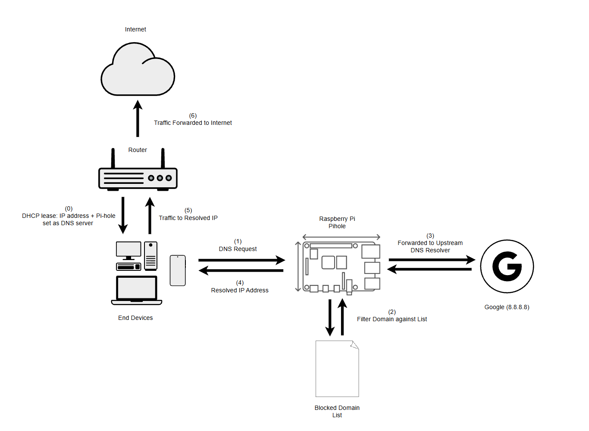

# Pi-hole Homelab Project

## Overview

This project documents the deployment and configuration of **Pi-hole** on a Raspberry Pi to provide DNS-based ad and tracker blocking for devices on my local network.

The goal of this project was to gain hands-on experience with DNS, Linux administration, network configuration, and troubleshooting while building a practical homelab environment.

## Objectives

- Install and configure Pi-hole on a Raspberry Pi.
- Establish a consistent IP address using a DHCP reservation.
- Understand how DNS resolution works and how Pi-hole filters DNS requests.
- Configure end devices to use a local DNS server.
- Monitor DNS activity through Pi-hole's web dashboard.

**Network Overview:**



### Network Configuration

| Component | Configuration |
|---|---|
| DNS Server | Raspberry Pi running Pi-hole |
| Hostname | `pihole` |
| Connection | Ethernet |
| IPv4 Address | `192.168.0.123` |
| IP Assignment | DHCP Reservation |
| DNS Upstream Provider | Google |
| Client Device | Windows 11 PC |
| DNS Configuration | Manually configured |

## Project Structure

The project is organized into separate sections documenting each stage of the deployment.

```text
lab-07-pihole/
│
├── README.md
│
├── 01 - Hardware and OS/
│   └── README.md
│
├── 02 - Network Configuration/
│   └── README.md
│
├── 03 - Pihole Installation/
│   └── README.md
│
├── 04 - Pihole Dashboard/
│   └── README.md
│
├── 05 - End Device Configuration/
│   └── README.md
│
└── Images/
    └── ...
```

## Documentation

| Section | Description |
|---|---|
| [01 - Hardware and OS](01%20-%20Hardware%20and%20OS/README.md) | Raspberry Pi OS installation, initial provisioning, and remote SSH access. |
| [02 - Network Configuration](02%20-%20Network%20Configuration/README.md) | Ethernet connectivity, IP addressing, and DHCP reservation. |
| [03 - Pi-hole Installation](03%20-%20Pihole%20Installation/README.md) | Operating system updates, Pi-hole installation, and initial configuration. |
| [04 - Pi-hole Dashboard](04%20-%20Pihole%20Dashboard/README.md) | Accessing the web interface, monitoring DNS statistics, and reviewing query logs. |
| [05 - End Device Configuration](05%20-%20End%20Device%20Configuration/README.md) | Configuring Windows 11 to use Pi-hole as its IPv4 and IPv6 DNS server. |

## Technologies & Tools

- **Hardware:** Raspberry Pi
- **Operating System:** Raspberry Pi OS
- **DNS Software:** Pi-hole
- **Networking:** IPv4, IPv6, DHCP, DNS
- **Remote Administration:** SSH
- **Client Operating System:** Windows 11
- **Troubleshooting Tools:** PowerShell, `ipconfig`, `nslookup`

## What I Learned

- Deploying and administering a Linux-based device.
- Establishing network connectivity and configuring DHCP reservations.
- Understanding DNS resolution and the role of upstream DNS providers.
- Configuring a local DNS server and connecting client devices to it.
- Understanding the differences between IPv4 and IPv6 DNS configuration.
- Using SSH to remotely administer a Raspberry Pi.
- Monitoring DNS requests and identifying clients through Pi-hole's Query Log.
- Troubleshooting DNS resolution using `nslookup` and other networking utilities.

## Future Improvements

- Explore configuring IPv6 DNS throughout the local network.
- Test ad and tracker blocking using known blocked domains.
- Investigate DNS filtering behavior and analyze DNS traffic with Wireshark.
- Explore integrating Pi-hole with other homelab services.